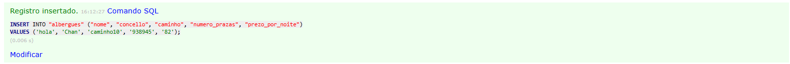

# e1-albergues

- Ex 1  

    1. Clone repository with ssh
 ```git clone git@github.com:davidfernandowirtz/e1-albergues.git```

    2. Go to repository
 ```cd e1-albergues```

    3. Run docker
```docker compose up -d || docker compose up```

- Ex 2

    | Paso | Comando | Resultado obtido |
    | --- | --- | --- |
    | 1 | `docker compose up -d` | ✔ Network `e1-albergues_datos` create succesfully.<br> ✔ Volume `e1-albergues_mysqldata` create succesfully.<br>✔ Container `e1-albergues-db-1` started and state `Healthy`.<br>✔ Container `e1-albergues-adminer-1` started succesfully. |
    | 2 | Inserir un albergue novo desde Adminer |  |
    | 3 | `docker compose down` e `docker compose up -d` | ✔ Container e1-albergues-adminer-1 removed succesfully.<br> ✔ Container e1-albergues-db-1 removed succesfully.<br> ✔ Network e1-albergues_datos removed succesfully.<br> ✔ Network `e1-albergues_datos` create succesfully.<br>✔ Volume `e1-albergues_mysqldata` create succesfully.<br>✔ Container `e1-albergues-db-1` started and state `Healthy`.<br>✔ Container `e1-albergues-adminer-1` started succesfully.
    | 4 | `docker compose down -v` e `docker compose up -d` | ✔ Container e1-albergues-adminer-1 removed succesfully.<br> ✔ Container e1-albergues-db-1 removed succesfully.<br> ✔ Volume e1-albergues_mysqldata removed successfully.<br> ✔ Network e1-albergues_datos removed succesfully.<br> ✔ Network `e1-albergues_datos` create succesfully.<br>✔ Volume `e1-albergues_mysqldata` create succesfully.<br> ✔ Volume e1-albergues_mysqldata create successfully.<br> ✔ Container `e1-albergues-db-1` started and state `Healthy`.<br>✔ Container `e1-albergues-adminer-1` started succesfully. |

- Ex 3
    The differences between 3 and 4 is basically that if you executed the command line docker compose up -v you will delete containers,images and ALSO the volumes.
